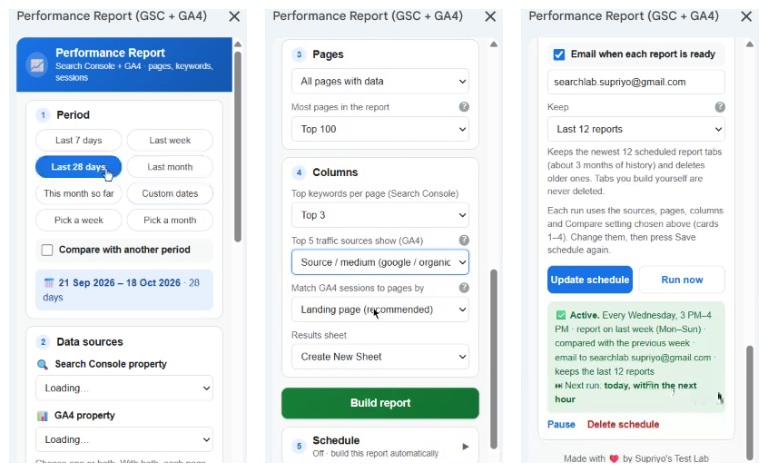
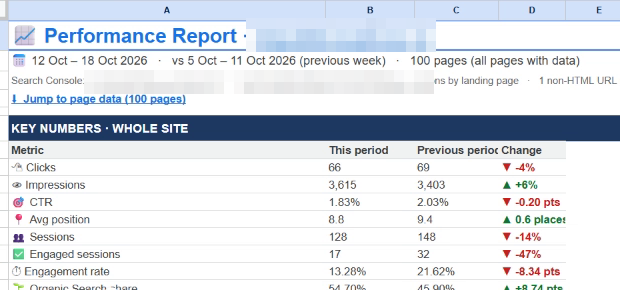
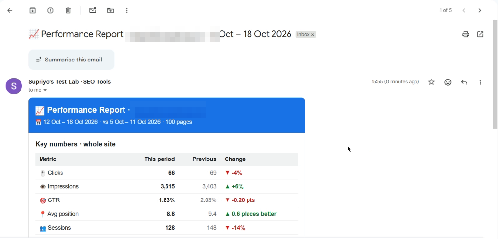

Every SEO knows the routine. Export the Performance report from Google Search Console. Export the landing pages report from GA4. Paste both into a spreadsheet. Fight with trailing slashes, `www` and query strings so the URLs match. Write a VLOOKUP. Fix the VLOOKUP. Build the same report again next week.

It takes 30–60 minutes per site, every time, and the result is often wrong: GA4 shows paths (`/blog/post/`) while Search Console shows full URLs (`https://www.example.com/blog/post`), so half the rows don't match without anyone noticing.

This guide shows a better way. With one free Google Apps Script, a Google Sheet becomes a **combined Search Console + GA4 report builder**. Pick a period, pick your properties, click **Build report**, and in about a minute you get:

- clicks, impressions, CTR, position, sessions and engagement **for every page, side by side**,
- a dashboard with the key numbers and plain-language findings,
- quick wins, biggest gainers and losers, low-CTR pages, top queries and traffic channels,
- optional **weekly or monthly reports emailed automatically** to you or your client.

Below you'll see exactly what the report shows, why it saves so much time, and a step-by-step setup guide, even if you have never opened Apps Script before.

## Why Search Console and GA4 belong in the same report

Search Console and GA4 answer two different halves of one question.

| Search Console tells you… | GA4 tells you… |
| --- | --- |
| How often a page appears in Google (impressions) | How many visits the page gets (sessions) |
| How many searchers click it (clicks, CTR) | Whether visitors engage or leave (engagement rate) |
| Where it ranks (average position) | Where the visits come from (Organic, Direct, Referral, AI assistants…) |
| Which queries bring it traffic | What happens after the click |

Looked at separately, each tool hides half the story:

- A page with **rising impressions but falling clicks** needs a better title and meta description, not more content. You only see this in Search Console.
- A page with **good clicks but low engagement** has a content or intent problem. You only see this when GA4 sits next to the click data.
- A page with **search clicks but no GA4 landing sessions** usually has a tracking problem: a missing tag, a redirect, or a consent banner blocking GA4.

That last one is a classic hidden issue. You'll never spot it unless both numbers sit in the same row.

### The real cost of doing it by hand

- **Time:** two exports, cleaning, matching and formatting take 30–60 minutes per site per report. Agencies repeat that for every client, every week or month.
- **URL matching errors:** GA4 reports paths and hostnames separately; Search Console uses full URLs. Trailing slashes, `www`, upper-case letters and `?utm=` parameters break lookups silently.
- **Sampling of the wrong pages:** exports from the interfaces are capped (Search Console shows 1,000 rows), so large sites lose most of their long-tail pages.
- **No insight, only numbers:** a spreadsheet of numbers doesn't tell a client what to do next.

The script fixes all four: it reads both APIs directly (up to 100,000 Search Console rows), normalises URLs so pages match, and writes the findings in plain language.

## What the combined SEO report gives you

Everything runs from a sidebar inside Google Sheets. You make four choices, click **Build report**, and the script writes a new tab with a dashboard on top and the full page table below.



### 1. Flexible periods and comparisons

Choose **Last 7 days, Last week (Mon–Sun), Last 28 days, Last month, This month so far, Pick a week, Pick a month** or **Custom dates**. Tick **Compare with another period** to add ▲▼ change columns against the **previous period** or the **same period last year**. The sidebar warns you when the last 2–3 days are still incomplete in Search Console.

### 2. Search Console, GA4, or both

The property lists load from your own Google account. Pick a Search Console property, a GA4 property, or both. When the names match, the script even suggests the right GA4 property for your Search Console site.

### 3. Every page, or only the pages you care about

- **All pages with data** (top 100, 500, 1,000, 5,000 or all), sorted by clicks.
- **Current cell selection**: select URLs anywhere in your sheet.
- **Paste my URLs**: a client's priority pages, a content cluster, last month's new blog posts.

PDFs, images and other files are left out automatically, so the report only shows web pages.

### 4. The columns SEOs actually need

For each page:

| Search Console | GA4 |
| --- | --- |
| Impressions, Clicks, CTR, Avg Position | Sessions, Engaged Sessions, Engagement Rate |
| Top 3, 5 or 10 keywords per page | Top 5 traffic sources (channel, source / medium, or source) |
| Δ change columns when comparing | Δ change columns when comparing |

You choose whether GA4 sessions are matched by **landing page** (recommended, best next to search clicks) or **any page view**.

### 5. A dashboard with findings, not just numbers



Above the page table, every report includes:

- **Key numbers for the whole site:** clicks, impressions, CTR, position, sessions, engaged sessions, engagement rate and Organic Search share, with ▲▼ changes.
- **Key findings, written in plain language**, for example:
    - "More people see the site in Google but fewer click (CTR −0.20 pts). Review titles and meta descriptions of the pages losing clicks."
    - "The top 10 pages bring 73% of the clicks: search traffic depends on a few pages. Protect them."
    - "14 pages lost 23 clicks; the top 3 explain 35% of the loss. Start there."
    - "3 pages get 20+ search clicks but no GA4 sessions as a landing page. Check the GA4 tag, redirects and the consent banner."
- **Short top lists:** top 10 pages, biggest gainers and losers, **quick wins** (positions 4–20 with the most impressions), **low CTR on page 1**, **low engagement** pages, the site's top search queries and GA4 traffic channels.
- A **Jump to page data** link straight to the full table.

It's the report you would build for a client, already written.

## How to set it up (step-by-step, about 15 minutes)

Until the add-on launches (more on that at the end), the Performance Report runs as an **Apps Script attached to one Google Sheet**. It's free, it runs inside your own Google account, and nothing is sent to any outside server. The setup is done once per sheet.

**You'll need:**

- A Google account with access to the **Search Console property** (any permission level) and/or **Viewer access to the GA4 property**.
- The script file **[`performance-report.gs`](https://github.com/supriyo-mallick/supriyo-mallick.github.io/blob/main/public/downloads/performance-report.gs)** and the manifest **[`appsscript.json`](https://github.com/supriyo-mallick/supriyo-mallick.github.io/blob/main/public/downloads/appsscript.json)** (free, also linked at the end of this post).
- A Google Cloud project. It's free and no billing account is needed.

### Step 1: Create the sheet and paste the script

1. Create a new Google Sheet, for example "SEO Report – client name".
2. Go to **Extensions → Apps Script**. A new script project opens in a new tab.
3. Rename the default `Code.gs` to **`performance-report`** (click the three dots → Rename).
4. Select everything in it, delete it, and paste the full contents of `performance-report.gs`.
5. Add the menu: paste this small block at the very end of the file, so a **SEO Tools** menu appears in the sheet:

```js
function onOpen() {
  SpreadsheetApp.getUi().createMenu("SEO Tools")
    .addItem("Performance Report (GSC + GA4)", "openPerformanceReport")
    .addToUi();
}
```

6. Press **Ctrl + S** to save.

### Step 2: Add the permissions file (appsscript.json)

1. In Apps Script, click **⚙ Project Settings** in the left bar.
2. Tick **Show "appsscript.json" manifest file in editor**.
3. Go back to the **‹› Editor**, open **appsscript.json**, replace its contents with the provided file, and save. It contains these scopes:

```json
"oauthScopes": [
  "https://www.googleapis.com/auth/spreadsheets",
  "https://www.googleapis.com/auth/webmasters.readonly",
  "https://www.googleapis.com/auth/analytics.readonly",
  "https://www.googleapis.com/auth/script.external_request",
  "https://www.googleapis.com/auth/script.scriptapp",
  "https://www.googleapis.com/auth/script.container.ui",
  "https://www.googleapis.com/auth/script.send_mail",
  "https://www.googleapis.com/auth/userinfo.email"
]
```

Search Console and Analytics access is **read-only**. The script can't change anything in your properties.

### Step 3: Create a Google Cloud project and enable 3 APIs

Apps Script's default project can't use the Search Console or Analytics APIs, so you connect your own (free) project.

1. Open [console.cloud.google.com](https://console.cloud.google.com/projectcreate) and click **New project**. Give it a name, for example "SEO Reports", and click **Create**.
2. With that project selected at the top, go to **☰ → APIs & Services → Library** and **Enable** these three APIs:
    - **Google Search Console API**: clicks, impressions, keywords.
    - **Google Analytics Data API**: GA4 sessions and engagement.
    - **Google Analytics Admin API**: fills the GA4 property list. Without it, you can still type the property ID.

### Step 4: Set up the OAuth consent screen

1. Go to **☰ → Google Auth Platform → Overview → Get started**.
2. Enter an app name (e.g. "SEO Reports") and your email → **Next**.
3. Audience: **External** → **Next**. Contact email → **Next**. Accept the policy → **Create**.
4. Go to **Audience → Test users → + Add users**, add the Gmail you'll use in the sheet (and your teammates'), and **Save**.

The app stays in **Testing** mode. That's fine for your own reports and your team (up to 100 test users).

### Step 5: Link the Cloud project to your script

1. In Google Cloud, open **☰ → Cloud overview → Dashboard** and copy the **Project number** (digits only).
2. In Apps Script, go to **⚙ Project Settings → Google Cloud Platform (GCP) Project → Change project**, paste the number, and click **Set project**.

### Step 6: Authorise and test with checkReportSetup

1. In the Apps Script editor, open `performance-report.gs`.
2. In the function dropdown at the top, choose **`checkReportSetup`** (not `openPerformanceReport`) and click **▷ Run**.
3. Click **Review permissions**, choose your Gmail. On "Google hasn't verified this app", click **Advanced → Go to (your app name)**. That's expected for your own test app. Tick all permissions (or **Select all**) and click **Continue**.
4. Open the **Execution log**. You should see three green ticks:

```
✅ Search Console: 4 property/ies found
✅ GA4 property list (Admin API): 2 property/ies: ...
✅ GA4 report data (Data API): ... had 1,240 sessions in the last 30 days
```

**If you see a ❌, check the message.** The most common fixes:

| Message | Fix |
| --- | --- |
| "…API has not been used / is disabled" | Enable that API in Step 3 (in the same project as Step 5), wait 1–2 minutes, run again. |
| "Missing permission" | Google reused an old approval. Go to [myaccount.google.com/connections](https://myaccount.google.com/connections), open your app, **Delete all connections**, and run `checkReportSetup` again. |
| "Error 403: access_denied" when signing in | Your Gmail isn't a **Test user** (Step 4). Add it in the same project. |
| "No access to this GA4 property" | Ask for at least **Viewer** access in GA4 → Admin → Property access management. |

Once all three are green, the setup is done for good. Reload the Google Sheet and the **SEO Tools** menu appears.

## Build your first combined report

1. In the sheet, open **SEO Tools → Performance Report (GSC + GA4)**. The sidebar opens on the right.
2. **Period:** click **Last 28 days** and tick **Compare with another period → Previous period**.
3. **Data sources:** choose your Search Console property and your GA4 property.
4. **Pages:** keep **All pages with data → Top 500**, or paste your own list of URLs.
5. **Columns:** choose **Top 5** keywords, the traffic-source type (Channel is the easiest to read for clients), and **Landing page** matching.
6. **Results sheet:** **Create New Sheet**.
7. Click **Build report**. A progress list shows each step. Most sites finish in under a minute, because the script fetches every page in one request instead of one request per page.
8. Click **Open report ↗**. Read the dashboard first, then use **Jump to page data** for the full table. Filter it, sort it, or share the tab with your client.

Your choices are remembered for this sheet, so next time it's two clicks.

### Automate it: weekly or monthly reports by email

Open the **5 · Schedule** card at the bottom of the sidebar:

- **Repeat:** Weekly (reports on last week, Mon–Sun) or Monthly (reports on last month).
- **Day and time:** Wednesday or later is recommended for weekly reports, and day 4 or later for monthly ones, because Search Console data takes 2–3 days to complete.
- **Email when each report is ready:** add your address and your client's (up to 10).
- **Keep:** the last 6, 12, 24 or 52 reports, so old tabs are deleted and the sheet stays tidy. Tabs you build by hand are never touched.

Click **Save schedule**. Use **Run now** once to test it: a new report tab appears and the email arrives with the key numbers, the top findings and a button to open the full report.



The schedule runs on Google's servers, so your computer doesn't need to be on and the sheet doesn't need to be open.

## How SEO professionals use it

- **Monthly client reporting:** schedule a monthly report with **Compare → Same period last year** and email it to the client. The findings section is your executive summary.
- **Traffic-drop investigations:** compare the last 7 or 28 days with the previous period. The *Biggest losers* list and the "top 3 explain X% of the loss" finding tell you where to look first.
- **Finding quick wins:** the *Quick wins* list shows pages ranking 4–20 with the most impressions, the cheapest clicks you'll ever get. Add internal links, refresh the content, match the intent.
- **CTR optimisation:** *Low CTR on page 1* lists pages ranking in the top 10 with less than half your site's average CTR. Rewrite their titles and meta descriptions.
- **Content audits:** paste a list of blog posts and compare search visibility with engagement. High impressions with low engagement means the content doesn't match the search intent.
- **Tracking QA:** the "search clicks but no GA4 sessions" finding catches broken tags, redirects and consent-banner problems.
- **Migrations:** the "had 100+ impressions before and none now" finding shows pages that disappeared after a redesign or URL change.

### Tips for accurate numbers

- **Whole-site totals come from the property itself**, so they don't equal the sum of the page rows. Search Console hides anonymised queries from page-level data. This is normal.
- **Use Landing page matching** next to search data: it counts sessions that *started* on the page, the closest match to a search click.
- **Search Console and GA4 never match exactly.** A click isn't always a session (consent banners, ad blockers, bounces before GA4 loads). Compare trends, not exact numbers.
- **Leave a 3-day buffer** for recent data. The sidebar warns you automatically.

## FAQ

**Is it free?** Yes. The script, Google Sheets, Apps Script and the Google APIs used here are free for this kind of use.

**Is my data safe?** The script runs inside your own Google account. Data goes straight from Google's APIs into your spreadsheet, with no external server in between. Search Console and GA4 access is read-only.

**Can I use it for several clients?** Yes, with one sheet per client. Each sheet remembers its own properties and schedule. In the current script version, every new sheet needs Steps 1–2 and 5–6 again; the Cloud project from Steps 3–4 can be reused.

**Does it work for large sites?** Yes. It reads up to 100,000 pages from Search Console and up to 250,000 GA4 rows, and you can cap the report at the top 100–5,000 pages.

**Why does Google say "this app isn't verified"?** Because it's your own private Apps Script project in Testing mode. You're the developer and the user, so clicking **Advanced → Go to (app name)** is safe. The upcoming add-on removes this step.

## Coming soon: SEO Tools as a Google Sheets add-on

We're preparing to launch the Performance Report, plus **three more tools**, as one free **Google Sheets add-on** on the Google Workspace Marketplace. Together they automate the day-to-day jobs SEO teams repeat every week:

1. **On-Page & Tech Audit:** crawl a whole site, one folder or a list of URLs and get a Page Audit, Site Health checks and a Summary with a health score and quick wins, in your sheet.
2. **Check Indexing (GSC):** bulk-inspect URLs with Google's URL Inspection API: index status, last crawl, canonicals, sitemaps and rich results.
3. **Sitemap URL Extractor:** pull every URL from a sitemap or sitemap index, including child sitemaps, in seconds.
4. **Performance Report (GSC + GA4):** everything in this guide.

**What changes when the add-on goes live:**

| Today (Apps Script version) | With the add-on |
| --- | --- |
| Google Cloud project, APIs, consent screen and script setup | **Install once** from the Marketplace, click Allow, done |
| Works in the one sheet where you pasted the script | Works in **every Google Sheet** you open |
| "Unverified app" warning on first sign-in | Verified by Google |
| Updates mean pasting new code | Updates arrive automatically |

The add-on is currently going through Google's verification process. **Until it's live, use the Apps Script version above**: it's the same Performance Report, just with a one-time setup per sheet.

**Want to know when it launches?** Subscribe to **Search Lab by Supriyo Mallick** on YouTube or email [searchlab.supriyo@gmail.com](mailto:searchlab.supriyo@gmail.com). Questions, bugs and feature requests are welcome too.

---

## Download the files

| File | What it is | Get it |
| --- | --- | --- |
| `performance-report.gs` | The Performance Report script (Step 1) | [View on GitHub](https://github.com/supriyo-mallick/supriyo-mallick.github.io/blob/main/public/downloads/performance-report.gs) · [Download](/downloads/performance-report.gs) |
| `appsscript.json` | The permissions file (Step 2) | [View on GitHub](https://github.com/supriyo-mallick/supriyo-mallick.github.io/blob/main/public/downloads/appsscript.json) · [Download](/downloads/appsscript.json) |

On GitHub, click the **Copy raw file** button (top right of the code) and paste it straight into Apps Script.
